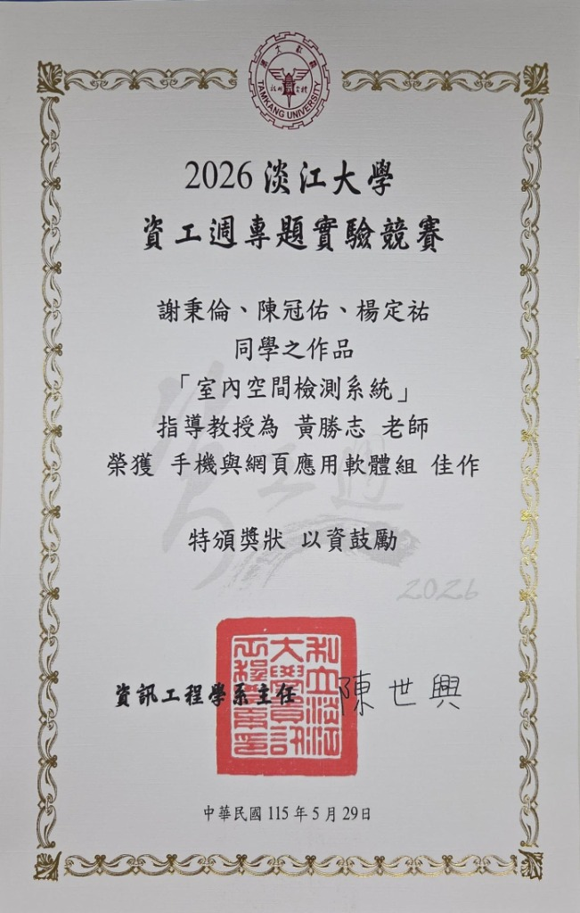

## 2026 淡江大學資工週專題實驗競賽 — 手機與網頁應用軟體組 佳作

指導學生開發專題作品 **「室內空間檢測系統」**，榮獲 115 學年度（2026）淡江大學資訊工程學系資工週專題實驗競賽「手機與網頁應用軟體組」佳作。

* **競賽名稱：** 2026 淡江大學資工週專題實驗競賽
* **競賽組別：** 手機與網頁應用軟體組
* **獲獎獎項：** 佳作
* **專題名稱：** 室內空間檢測系統
* **指導教授：** 黃勝志（Sheng-Zhi Huang）
* **獲獎學生：** 謝秉倫、陳冠佑、楊定祐
* **獲獎日期：** 2026 年 5 月 29 日（中華民國 115 年 5 月 29 日）

