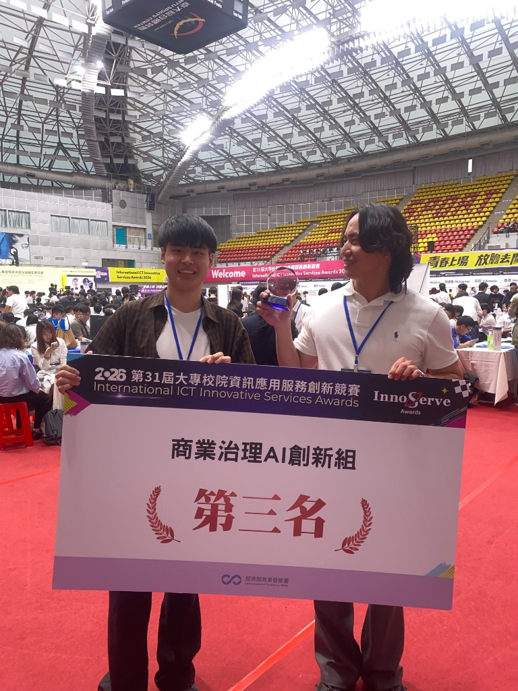

## 2026 第31屆大專校院資訊應用服務創新競賽（InnoServe Awards）— 商業治理 AI創新組 第三名

指導學生團隊跨校合作開發 **「blooop — 即時社群 24 小時泡泡地圖」**，於 2026 年第 31 屆大專校院資訊應用服務創新競賽榮獲「商業治理 AI創新組」全國第三名。

* **競賽名稱：** 2026 第31屆大專校院資訊應用服務創新競賽（International ICT Innovative Services Awards）
* **競賽組別：** 商業治理 AI創新組
* **獲獎名次：** 第三名（3rd Place）
* **專題名稱：** blooop — 即時社群 24 小時泡泡地圖
* **參賽學校：** 淡江大學、國立中興大學
* **指導教授：** 黃勝志（Sheng-Zhi Huang）
* **獲獎學生：** 嚴喆、許博勛

